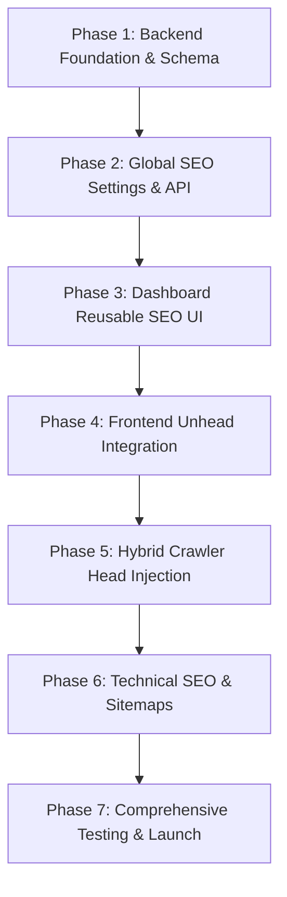

# Centralized SEO & Metadata Implementation Plan for SiS (Superior Integrated Solutions)

> **Document Version:** 1.0.0  
> **Target System:** SiS Enterprise Web Application (Laravel 11 API Backend + Vue 3 / Vite SPA Frontend)  
> **Status:** Architecture Specification & Implementation Roadmap  
> **Constraint Reminder:** Planning and architectural documentation only. No application code, database migrations, or configuration files have been altered during this planning phase.

---

## 1. Executive Summary & Project Context

### 1.1 Objective
This document provides an exhaustive, production-grade architectural blueprint for introducing a centralized, dynamic, and localized Search Engine Optimization (SEO) and social metadata management system across the entire SiS digital ecosystem. 

Superior Integrated Solutions (SiS) operates as an industrial technology and automation enterprise specializing in industrial automation, process control, digital solutions, OT cybersecurity, and industrial AI. The platform serves two primary audiences:
1. **B2B Industrial Buyers and Decision-Makers** searching for engineering, automation, and cybersecurity solutions across the MENA region and globally.
2. **Internal Content Operators & Executives** who curate service offerings, case studies, partner ecosystems, and corporate credentials via an administrative dashboard.

### 1.2 The Core Problem Statement
Currently, the SiS web application operates as a single-page application (SPA) built with Vite and Vue 3, backed by a Laravel 11 REST API. The current SEO implementation is severely limited:
- `resources/frontEnd/index.html` holds static, build-time placeholder tags (`%VITE_SITE_NAME%`, `%VITE_SITE_DESCRIPTION%`, and fixed Open Graph references to `/sis-logo.png`).
- Client-side routing in `resources/frontEnd/src/router/index.js` only updates `document.title` on client-side route transitions, leaving meta descriptions, canonical links, Open Graph tags, and Twitter Cards unchanged.
- Dynamic catalog routes such as `/solution-pages/:slug` and `/use-cases` do not even update `<title>` upon receiving data from the API.
- All non-API web traffic is routed via a catch-all in `routes/web.php` that blindly returns `public/build/index.html`. Consequently, **social scrapers (LinkedIn, Twitter/X, WhatsApp, Facebook, iMessage) and non-JavaScript crawlers receive identical, static, generic fallback metadata for every single page URL.**
- There are no database tables, models, or CMS endpoints to manage SEO fields (meta titles, descriptions, canonical URLs, robots directives, or structured data).
- There is no dynamic XML sitemap (`/sitemap.xml`) or crawler-tailored `robots.txt`.

### 1.3 Architectural Vision
The solution introduces a unified, hybrid SEO architecture:
1. **CMS & Storage Layer:** A polymorphic, bilingual (`en`/`ar`) metadata model linked to all manageable models (`SolutionPage`, `Project`, `Sector`, etc.) coupled with a singleton `SeoSetting` registry for global and static page fallbacks.
2. **Dashboard Management Layer:** A reusable, reactive Vue 3 SEO editor embedded across all content forms featuring live Google SERP and Social Card previews, character-count indicators, automated fallback computation, and granular indexing toggles.
3. **Frontend SPA Engine:** Integration of `@unhead/vue` with a custom `useSeo()` composable ensuring reactive, leak-free head mutations, canonical synchronization, and JSON-LD structured data injection during in-app navigation.
4. **Backend Crawler Edge (Prerender/SSR Hybrid):** A lightweight crawler detection middleware in Laravel's web routing (`routes/web.php`) that parses incoming User-Agents. If a social crawler or legacy search bot is detected, Laravel injects resolved Open Graph, Twitter, and canonical tags directly into `index.html` before streaming the response, guaranteeing instant, 100% accurate social previews without requiring a full Node.js SSR migration.
5. **Technical Infrastructure:** Automated XML sitemap generation (`/sitemap.xml` with dynamic priority and `lastmod` tracking), strict canonical URL normalization, environment-aware `robots.txt`, and comprehensive Schema.org JSON-LD structured data.

---

## 2. Phase 1: Existing Architecture & Complete Audit Findings

### 2.1 Frontend Inspection
* **Framework & Build Stack:** Vue 3 (`^3.4.0`), Vite (`^5.4.1`), Vue Router 4 (`^4.x`), Pinia (`^3.0.4`), Tailwind CSS (`^3.4.17`), Axios (`^1.7.9`).
* **Existing Meta Handling:**
  - `resources/frontEnd/index.html`: Contains static head elements with hardcoded tokens:
    ```html
    <title>%VITE_SITE_NAME%</title>
    <meta name="description" content="%VITE_SITE_DESCRIPTION%" />
    <meta property="og:type" content="website" />
    <meta property="og:site_name" content="%VITE_SITE_NAME%" />
    <meta property="og:url" content="/" data-runtime-url />
    <meta property="og:title" content="%VITE_SITE_NAME%" />
    <meta property="og:description" content="%VITE_SITE_DESCRIPTION%" />
    <meta property="og:image" content="/sis-logo.png" data-runtime-image />
    <meta name="twitter:card" content="summary_large_image" />
    <link rel="canonical" href="/" data-runtime-url />
    ```
  - `resources/frontEnd/src/main.js`: Contains a one-time utility `updateRuntimeMetadata()` executing synchronously on bundle initialization:
    ```javascript
    function updateRuntimeMetadata() {
        const pageUrl = new URL(window.location.pathname, window.location.origin).href;
        const imageUrl = new URL(`${import.meta.env.BASE_URL}sis-logo.png`, window.location.origin).href;
        document.querySelectorAll('[data-runtime-url]').forEach(el => el.setAttribute(el.tagName === 'LINK' ? 'href' : 'content', pageUrl));
        document.querySelectorAll('[data-runtime-image]').forEach(el => el.setAttribute('content', imageUrl));
    }
    ```
    *Flaw:* This only runs once upon initial script evaluation. Subsequent client-side navigation within the SPA leaves `og:url`, `og:image`, and canonical links stale or pointing to the root.
  - `resources/frontEnd/src/router/index.js`:
    ```javascript
    router.afterEach((to) => {
        document.title = to.meta?.title || defaultTitle;
        navigating.value = false;
    });
    ```
    *Flaw:* Only mutates `document.title`. Does not update meta description, Open Graph, Twitter cards, canonical tags, or structured data.
  - **Dynamic Detail Views:** In `BasicServicesPage.vue` (`/solution-pages/:slug`), asynchronous data loading via `api.getSolutionPage(slug)` does not alter `document.title` or head tags; the document title remains frozen as `"Services & Solutions | SiS"`.

### 2.2 Dashboard Inspection
* **Layout & Navigation:** Located in `resources/frontEnd/src/SIS-Dashboard/`. Protected by route guards checking `localStorage.getItem("admin_token")` and expiration timestamps.
* **Content Modules:**
  - `SolutionPagesManager.vue`: Manages 12 predefined industrial solution templates plus custom pages. Handles hero titles, badges, services, multi-step approaches, and CTAs. Zero SEO controls currently exist.
  - `UseCasesManager.vue` / `AdminProjectController.php`: Manages case studies and projects (slug, title, client, location, summary, technologies, metrics, results). Zero SEO fields.
  - `IndustriesManager.vue` / `AdminCollectionController.php`: Manages industry sectors (`Sector` model) with translations, icons, programs, and scopes.
  - `AboutManager.vue`, `HeaderManager.vue`, `FooterManager.vue`, `ContactPageManager.vue`, `PartnersManager.vue`: Dedicated editor interfaces storing content through specific REST endpoints. None of these have SEO fields.

### 2.3 Backend Inspection
* **Framework:** Laravel 11.x on PHP 8.2+, Sanctum token authentication, Spatie Translatable (`spatie/laravel-translatable`) for JSON-based bilingual storage (`en` and `ar`).
* **Web Entry Point (`routes/web.php`):**
  ```php
  Route::get('/{any}', function () {
      $headers = ['Content-Type' => 'text/html; charset=UTF-8'];
      $target = request()->getRequestUri();
      if (is_file(public_path()."/build/$target")) {
          $target = "build/$target";
      } elseif (!is_file(public_path()."/$target")) {
          $target = 'build/index.html';
      }
      // MIME overrides ...
      return response(File::get(public_path()."/$target"))->withHeaders($headers);
  })->where('any', '^(?!(api)).*$');
  ```
  *Flaw:* Direct file streaming of compiled Vite HTML without dynamic server-side header replacement for search bots and social platforms.
* **Public Robots File (`public/robots.txt`):**
  ```text
  User-agent: *
  Disallow:
  ```
  *Flaw:* Does not protect `/dashboard/*` or `/api/*` from search indexation. Does not declare the XML sitemap location.
* **Database Models:** 32 models identified (`SolutionPage`, `Project`, `Sector`, `Partner`, `Client`, `ContactPage`, `HeaderSetting`, `FooterSetting`, etc.). **Zero SEO fields or relations currently exist.**
* **Caching Architecture:** Managed in `App\Support\CacheManager.php` and service classes using locale-tagged keys (`api_solution_page_{slug}_{locale}`, `api_use_cases_page_{locale}`). Cache invalidation is triggered using model lifecycle hooks (`DB::afterCommit`).

---

## 3. Complete Route Inventory

Every route configured in `resources/frontEnd/src/router/index.js` and `resources/frontEnd/src/SIS-Dashboard/router/adminRoutes.js` is classified below:

| Route Path | Component / View | Route Classification | Authoritative Data Source | Proposed SEO Handling & Indexing Policy |
| :--- | :--- | :--- | :--- | :--- |
| `/` | `pages/Home/HomePage.vue` | CMS-Managed Landing Page | `GET /api/v1/hero-home`, `/why-sis`, `/pillars` | **Index, Follow.** Global default title/description override. Schema: `Organization`, `WebSite`. |
| `/about` | `pages/About/AboutPage.vue` | CMS-Managed Information Page | `GET /api/v1/about-hero`, `/vision`, `/core-values`, `/timeline` | **Index, Follow.** Custom SEO title, description, OG. Schema: `AboutPage`, `BreadcrumbList`. |
| `/services` | `pages/services/ServicesPage.vue` | Dynamic Listing / Hub Page | `GET /api/v1/services`, `/solution-pages/menu` | **Index, Follow.** Service catalog hub. Schema: `CollectionPage`, `ItemList`. |
| `/projects` | `pages/projects/ProjectsPage.vue` | Dynamic Listing (Industries & Projects) | `GET /api/v1/projects`, `/sectors` | **Index, Follow.** Tabbed showcase. Canonical to base `/projects` without tab parameters. Schema: `CollectionPage`. |
| `/partner-ecosystem` | `pages/partnerEcosystem/partnerEcosystemPage.vue` | CMS-Managed Listing Page | `GET /api/v1/partner-ecosystem`, `/partners` | **Index, Follow.** Schema: `CollectionPage`, `Organization`. |
| `/contact` | `pages/Contact/ContactPage.vue` | CMS-Managed Contact Page | `GET /api/v1/contact-page` | **Index, Follow.** Schema: `ContactPage`, `LocalBusiness`. |
| `/solution-pages/:slug` | `pages/services&solutions/BasicServicesPage.vue` | Dynamic Detail / CMS Entity Page | `GET /api/v1/solution-pages/{slug}` | **Index, Follow.** Dedicated page-level SEO overrides. Fallback to solution title/description. Schema: `Service`. |
| `/use-cases` | `pages/useCases/UseCasesPage.vue` | Dynamic Listing / Filter Page | `GET /api/v1/use-cases` | **Index, Follow.** Filterable project catalog. Canonical to base URL. Schema: `CollectionPage`. |
| `/dashboard/login` | `SIS-Dashboard/pages/AdminLogin.vue` | Authentication Route | Client-side auth | **Noindex, Nofollow.** Excluded from sitemap. Set `X-Robots-Tag: noindex, nofollow`. |
| `/dashboard/*` (All 15 sub-routes) | `SIS-Dashboard/layouts/AdminLayout.vue` | Private CMS Administration | Sanctum Auth (`/api/v1/admin/*`) | **Noindex, Nofollow.** Strict header block `X-Robots-Tag: noindex, nofollow, noarchive`. Excluded from sitemap. |
| `/*` (Unmatched routes) | Unhandled / 404 Catch-all | System Route | Client-side routing | **Noindex, Nofollow.** Returns 404 header at edge where possible. Generic fallback title. |

---

## 4. Phase 2: Complete Metadata Specification

### 4.1 Category A: Core HTML Metadata
1. **Document Title (`<title>`):**
   - *Purpose:* Primary ranking signal and SERP link anchor text.
   - *Status:* Mandatory.
   - *Generation:* Page-specific override $\rightarrow$ Entity title $\rightarrow$ Global Site Name fallback. Pattern: `{Page Title} | {Site Suffix}` (e.g., `Industrial AI & Machine Learning Solutions | SiS`). Max recommended length: 50–60 characters.
   - *Validation:* String, 10–70 characters recommended, automatically trimmed, escaped against XSS.
2. **Meta Description (`<meta name="description">`):**
   - *Purpose:* SERP snippet display explaining page intent.
   - *Status:* Mandatory for indexable pages.
   - *Generation:* Page-specific override $\rightarrow$ First 160 characters of page summary/description $\rightarrow$ Global default description.
   - *Validation:* Plain text, HTML stripped, 50–160 characters recommended.
3. **Character Encoding (`<meta charset="UTF-8">`):**
   - *Status:* Mandatory. Document-level static tag. Must be within the first 1024 bytes of the HTML document.
4. **Viewport Configuration (`<meta name="viewport" content="width=device-width, initial-scale=1.0">`):**
   - *Status:* Mandatory. Document-level static tag.
5. **HTML Language Attribute (`<html lang="en" dir="ltr">` / `<html lang="ar" dir="rtl">`):**
   - *Status:* Mandatory. Must dynamically reflect the active user locale stored in Pinia / cookie (`en` vs `ar`) and set appropriate text direction (`ltr` vs `rtl`).
6. **Theme Color (`<meta name="theme-color" content="#070d1a">`):**
   - *Status:* Optional / Recommended. Sets mobile browser header chrome color matching SiS brand palette.
7. **Robots Directives (`<meta name="robots" content="...">`):**
   - *Status:* Mandatory on every response.
   - *Format:* Public pages: `index, follow, max-snippet:-1, max-image-preview:large, max-video-preview:-1`. Admin/error routes: `noindex, nofollow, noarchive`.
8. **Crawler-Specific Robots (`googlebot`, `bingbot`):**
   - *Status:* Conditionally applicable. Automatically inherit from the main `robots` tag unless special crawler restrictions are required.
9. **Referrer Policy (`<meta name="referrer" content="strict-origin-when-cross-origin">`):**
   - *Status:* Recommended technical security header/tag. Protects internal paths while preserving origin for external analytics.
10. **Format Detection (`<meta name="format-detection" content="telephone=no">`):**
    - *Status:* Optional / Recommended to prevent mobile Safari from auto-linking industrial model numbers or codes as telephone numbers.

*Deprecated / Excluded Tags:*
- `<meta name="keywords">`: **Obsolete & Omitted.** Ignored by Google since 2009. Creates bloat and exposes internal keyword strategy to competitors. Internal tags in dashboard will be preserved solely for internal editorial search.

---

### 4.2 Category B: Canonicalization & Indexing Controls
1. **Canonical URL (`<link rel="canonical" href="...">`):**
   - *Purpose:* Declares the authoritative URL for content to avoid duplicate-content penalties.
   - *Rule:* **Always absolute**, strictly lower-cased, forced HTTPS, without trailing slash (unless root), and **stripped of tracking parameters** (`utm_*`, `fbclid`, `session`, `tab`).
   - *Override:* Dashboard allows setting a manual canonical override only when syndicating content or consolidating variant URLs. Default is self-referencing canonical.
2. **Trailing Slash & Host Normalization:**
   - Unified standard: Strip trailing slashes on all subpaths (e.g., `https://sis-holding.com/about`, never `.../about/`).
   - Normalize apex to `www` or non-`www` at the web server / Cloudflare level before hits reach the application.
3. **Pagination & Query Parameters:**
   - Filtered views like `/use-cases?category=Energy` or `/projects?tab=oil-and-gas` must self-canonicalize to the clean base URL (`https://sis-holding.com/use-cases` and `https://sis-holding.com/projects`) to prevent index dilution of infinite filter variations.
4. **Deleted Pages & Status Codes:**
   - When an admin unpublishes or deletes a Solution Page, the public route must return a genuine `404 Not Found` or `410 Gone` (or `301 Moved Permanently` if a replacement redirect is specified in the CMS).

---

### 4.3 Category C: Open Graph Metadata (Facebook, LinkedIn, Slack, WhatsApp)
Open Graph metadata powers rich snippets when SiS links are shared across professional and messaging platforms.

| OG Property | Source / Logic | Validation / Constraints | Fallback |
| :--- | :--- | :--- | :--- |
| `og:title` | Page SEO Social Title Override | Max 95 characters | Page SEO Title $\rightarrow$ Entity Title |
| `og:description` | Page SEO Social Description Override | Max 200 characters | Page Meta Description $\rightarrow$ Global Default |
| `og:type` | `website` for listings/home; `article` for case studies | Must be valid OG type | `website` |
| `og:url` | Canonical Page Absolute URL | Valid HTTPS absolute URL | Current request URL |
| `og:image` | Page Social Image Upload | Absolute URL, min $1200\times630$ px, max 5MB, JPG/PNG/WebP | Global Default OG Image (`/images/og-default.jpg`) |
| `og:image:width` | Image metadata or asset calculation | Fixed `1200` | `1200` |
| `og:image:height` | Image metadata or asset calculation | Fixed `630` | `630` |
| `og:image:alt` | Derived from Image Alt text or Page Title | Descriptive text, max 100 characters | `{Page Title} - SiS Superior Integrated Solutions` |
| `og:site_name` | Global Setting | Constant: `SiS - Superior Integrated Solutions` | Global Setting |
| `og:locale` | Active app locale | `en_US` (English) or `ar_EG` / `ar_SA` (Arabic) | `en_US` |
| `og:locale:alternate` | Inactive alternate locale | `ar_EG` if active is `en_US`, and vice versa | Omitted if single language |

---

### 4.4 Category D: Twitter / X Card Metadata
Twitter tags ensure high-converting cards on X/Twitter.

* `twitter:card`: Always set to `summary_large_image` to maximize visual impact on feeds.
* `twitter:title`: Inherits from `og:title` or page SEO title.
* `twitter:description`: Inherits from `og:description` or meta description.
* `twitter:image`: Inherits from `og:image`.
* `twitter:image:alt`: Inherits from `og:image:alt`.
* `twitter:site`: Global setting (e.g., `@SiSHolding` if configured).
* `twitter:creator`: Corporate handle or author handle.

---

### 4.5 Category E: Search & Crawler-Specific Directives
1. **Search Engine Verification Tokens:**
   - Google Search Console: `<meta name="google-site-verification" content="...">`
   - Bing Webmaster Tools: `<meta name="msvalidate.01" content="...">`
   - *Storage:* Stored in the Global `SeoSetting` table, rendered strictly on the Home route (`/`).
2. **Google Robots Snippet Directives:**
   - `max-snippet:-1`: Permits Google to select the optimal snippet length.
   - `max-image-preview:large`: Authorizes Google to display high-resolution image thumbnails in SERPs and Google Discover.
   - `max-video-preview:-1`: Authorizes animated video snippets.

---

### 4.6 Category F: Structured Data / Schema.org (JSON-LD)
All structured data must be emitted as standalone `<script type="application/ld+json">` tags, dynamically generated and validated against Schema.org and Google Search Central requirements.

#### 1. `Organization` & `LocalBusiness` (Global / Home / Contact)
* **Target Routes:** `/`, `/contact`, `/about`
* **JSON-LD Schema Definition:**
```json
{
  "@context": "https://schema.org",
  "@graph": [
    {
      "@type": "Corporation",
      "@id": "https://sis-holding.com/#organization",
      "name": "SiS - Superior Integrated Solutions",
      "legalName": "Superior Integrated Solutions S.A.E.",
      "url": "https://sis-holding.com",
      "logo": {
        "@type": "ImageObject",
        "@id": "https://sis-holding.com/#logo",
        "url": "https://sis-holding.com/sis-logo.png",
        "caption": "SiS Logo"
      },
      "image": "https://sis-holding.com/sis-logo.png",
      "description": "Provider of end-to-end industrial automation, process control, OT cybersecurity, and industrial AI solutions.",
      "email": "sales@sis-holding.com",
      "telephone": "+20 1007 568 651",
      "address": {
        "@type": "PostalAddress",
        "addressLocality": "Cairo",
        "addressCountry": "EG"
      },
      "sameAs": [
        "https://www.linkedin.com/company/superior-for-integrated-solutions"
      ]
    },
    {
      "@type": "WebSite",
      "@id": "https://sis-holding.com/#website",
      "url": "https://sis-holding.com",
      "name": "SiS Superior Integrated Solutions",
      "publisher": {
        "@id": "https://sis-holding.com/#organization"
      },
      "inLanguage": ["en", "ar"]
    }
  ]
}
```

#### 2. `Service` (Solution Detail Pages)
* **Target Routes:** `/solution-pages/:slug`
* **Authoritative Source:** `SolutionPage` model and its related `SeoMetadata`.
* **JSON-LD Structure:**
```json
{
  "@context": "https://schema.org",
  "@type": "Service",
  "@id": "https://sis-holding.com/solution-pages/process-automation#service",
  "name": "Process Automation & Control Systems",
  "serviceType": "Industrial Automation & Engineering",
  "provider": {
    "@id": "https://sis-holding.com/#organization"
  },
  "description": "Turnkey DCS, SCADA, and PLC engineering solutions designed for complex continuous and batch industrial processes.",
  "areaServed": "Global",
  "hasOfferCatalog": {
    "@type": "OfferCatalog",
    "name": "Process Automation Engineering Disciplines",
    "itemListElement": [
      {
        "@type": "Offer",
        "itemOffered": {
          "@type": "Service",
          "name": "Distributed Control Systems (DCS) Migration"
        }
      }
    ]
  }
}
```

#### 3. `BreadcrumbList` (All Nested Public Pages)
* **Target Routes:** All pages except Home (`/`).
* **Example (`/solution-pages/process-automation`):**
```json
{
  "@context": "https://schema.org",
  "@type": "BreadcrumbList",
  "itemListElement": [
    {
      "@type": "ListItem",
      "position": 1,
      "name": "Home",
      "item": "https://sis-holding.com"
    },
    {
      "@type": "ListItem",
      "position": 2,
      "name": "Services & Solutions",
      "item": "https://sis-holding.com/services"
    },
    {
      "@type": "ListItem",
      "position": 3,
      "name": "Process Automation",
      "item": "https://sis-holding.com/solution-pages/process-automation"
    }
  ]
}
```

#### 4. `ContactPage` (Contact Route)
* **Target Route:** `/contact`
* **JSON-LD Structure:**
```json
{
  "@context": "https://schema.org",
  "@type": "ContactPage",
  "name": "Contact SiS Engineering & Sales",
  "url": "https://sis-holding.com/contact",
  "mainEntity": {
    "@id": "https://sis-holding.com/#organization"
  }
}
```

---

### 4.7 Category G: Images, Video & Media SEO
1. **Descriptive Image Alt Text:**
   - Every image uploaded via the dashboard (hero images, solution service diagrams, partner logos, project covers) must accept an optional localized `alt_text` field.
   - Decorative elements (such as abstract background grid lines or particle effects) must strictly receive `alt=""` and `aria-hidden="true"`.
2. **Open Graph Image Standards:**
   - Optimal resolution: **$1200 \times 630$ pixels** (Aspect ratio: 1.91:1).
   - Minimum acceptable resolution: $600 \times 315$ pixels.
   - Max file size: 5 MB (optimized to $\le 350$ KB via Laravel WebP pipeline).
   - Format: JPG or PNG (high compatibility with older crawlers), or WebP where supported.
   - **Absolute URLs:** All social images must be fully qualified absolute URLs (`https://sis-holding.com/storage/seo/og-process.jpg`). Relative paths (`/storage/...`) will fail on WhatsApp and LinkedIn scrapers.
3. **Lazy Loading & Performance Considerations:**
   - Primary hero images and above-the-fold assets must use `loading="eager"` and `fetchpriority="high"`.
   - Below-the-fold content images must use `loading="lazy"` and `decoding="async"`.

---

## 5. Phase 3: Dashboard SEO Management Experience

### 5.1 Reusable Dashboard Component: `SeoFormSection.vue`
To avoid code duplication across the 15+ admin manager views, a modular, accessible Vue 3 component `SeoFormSection.vue` will be created in `resources/frontEnd/src/SIS-Dashboard/components/seo/`.

#### Component Structure & Visual Wireframe
```
+----------------------------------------------------------------------------------+
| 🔍 Search Engine Optimization (SEO) & Social Sharing                             |
+----------------------------------------------------------------------------------+
| [ Language: (●) English  ( ) العربية ]                                            |
|                                                                                  |
| SEO Page Title                                                                   |
| [ Industrial Automation & DCS Solutions | SiS                 ] [ 54/60 chars ]  |
| ℹ️ Appended with " | SiS - Superior Integrated Solutions" automatically.         |
|                                                                                  |
| Meta Description                                                                 |
| [ Expert engineering for mission-critical automation, SCADA, ] [ 138/160 chars ] |
| [ and DCS systems across industrial manufacturing sectors.   ]                   |
|                                                                                  |
| Search Engine Indexing Directives                                                |
| [x] Allow search engines to index this page (index)                              |
| [x] Allow search engines to follow links on this page (follow)                   |
|                                                                                  |
| Social Sharing Image (Open Graph / Twitter)                                      |
| [ Upload Image (1200x630 px) ] [ Preview: og-thumb.webp ] [ Clear ]              |
| ℹ️ Leave blank to use the page hero image or global default.                     |
|                                                                                  |
| Canonical URL Override (Advanced)                                                |
| [ https://sis-holding.com/solution-pages/industrial-automation  ]                |
| ⚠️ Leave empty to automatically use the standard self-referencing canonical URL. |
|                                                                                  |
| > Toggle Real-Time SERP & Social Previews [Expand]                               |
|   +----------------------------------------------------------------------------+ |
|   | 🌐 Google Search SERP Preview (Desktop & Mobile)                           | |
|   | https://sis-holding.com > solution-pages > industrial-automation           | |
|   | Industrial Automation & DCS Solutions | SiS                                | |
|   | Expert engineering for mission-critical automation, SCADA, and DCS...      | |
|   +----------------------------------------------------------------------------+ |
|   | 📱 LinkedIn / WhatsApp / Twitter Card Preview                              | |
|   | [ [ Image Preview 1200x630 ]                                             ] |
|   | SIS-HOLDING.COM                                                            | |
|   | Industrial Automation & DCS Solutions | SiS                                | |
|   | Expert engineering for mission-critical automation, SCADA, and DCS...      | |
|   +----------------------------------------------------------------------------+ |
+----------------------------------------------------------------------------------+
```

### 5.2 Field Validation & Editorial UX Rules
1. **Interactive Character Guidance:**
   - Title: Recommended 45–60 characters. Shows green indicator between 40 and 60, amber between 61 and 70, red over 70.
   - Meta Description: Recommended 120–160 characters. Shows progress bar and character count.
   - *Note:* These are displayed as editorial guidelines, never hard-blocking submission errors, because Google measures titles in pixel width (~600px), not strict character counts.
2. **Automated Fallbacks & Live Placeholders:**
   - When the SEO Title input is empty, the placeholder dynamically mirrors the main content title (e.g., `editingName.value || "Untitled Page"`).
   - When the Meta Description is empty, the placeholder dynamically mirrors the first 150 characters of the content description.
3. **Reset to Default Action:**
   - A single-click "Reset to System Defaults" button that clears overrides and restores automated derivation from page content.
4. **Duplicate Title & Slug Warning:**
   - Reactive validation flagging identical titles across different active solution pages to prevent internal keyword cannibalization.

### 5.3 Global SEO Settings Manager: `GlobalSeoManager.vue`
A dedicated settings module accessible under `/dashboard/seo-settings` for site-wide defaults:
* **Production Base URL:** e.g., `https://sis-holding.com` (Used for canonical calculations and sitemap generation).
* **Global Title Suffix / Separator:** e.g., `| SiS - Superior Integrated Solutions`.
* **Default Meta Description (Bilingual):** Fallback for static listing pages without dedicated entries.
* **Default Social Share Image:** Site-wide 1200x630 image.
* **Search Engine Verification Tokens:** Google Site Verification, Bing Webmaster code.
* **Default Robots Indexing Policy:** Global default toggle (`index, follow` vs maintenance `noindex, nofollow`).
* **Organization Schema Graph Data:** Legal name, logo URL, official contact phone, corporate email, address, and official LinkedIn/social profile URLs.

---

## 6. Phase 4: Data Model & API Contract

### 6.1 Architectural Trade-Off Analysis
We evaluate three database architectures for integrating SEO into the existing Laravel schema:

| Architectural Option | Pros | Cons | Decision |
| :--- | :--- | :--- | :--- |
| **Option A: Polymorphic `seo_metadata` Table** | • Keeps core content tables clean.<br>• Reusable across `SolutionPage`, `Project`, `Sector`, etc.<br>• Centralized model & observer logic.<br>• Consistent API resource transformation. | • Requires eager loading `with('seoMetadata')` to prevent N+1 queries. | **RECOMMENDED.** Provides maximum maintainability across all CMS entities without schema churn. |
| **Option B: JSON Column on Each Table** | • Zero joins required.<br>• Schema remains contained within each table. | • Cannot be applied to static pages (Home, About, Services) without synthetic rows.<br>• Harder to query or index in SQL. | *Rejected.* Fragments static page management. |
| **Option C: Add 8+ Columns to Every Table** | • Direct column queries. | • Massive schema duplication across 6+ tables.<br>• Migration maintenance overhead. | *Rejected.* Violates DRY and complicates schema evolution. |

### 6.2 Proposed Database Schema

#### Migration 1: Create Polymorphic `seo_metadata` Table
```php
Schema::create('seo_metadata', function (Blueprint $table) {
    $table->id();
    // Polymorphic relation (seoable_type, seoable_id)
    $table->morphs('seoable'); 
    
    // Translatable fields stored as JSON (en/ar)
    $table->json('meta_title')->nullable();
    $table->json('meta_description')->nullable();
    $table->json('og_title')->nullable();
    $table->json('og_description')->nullable();
    
    // Shared media and indexing controls
    $table->string('og_image')->nullable();
    $table->string('canonical_url')->nullable();
    $table->boolean('is_noindex')->default(false);
    $table->boolean('is_nofollow')->default(false);
    $table->string('schema_type')->nullable(); // e.g., 'Service', 'Article', 'ContactPage'
    $table->json('schema_overrides')->nullable(); // Custom JSON-LD properties if needed
    
    $table->timestamps();
    
    $table->unique(['seoable_type', 'seoable_id'], 'seoable_unique');
});
```

#### Migration 2: Create Global `seo_settings` Singleton Table
```php
Schema::create('seo_settings', function (Blueprint $table) {
    $table->id();
    $table->string('canonical_base_url')->default('https://sis-holding.com');
    $table->json('site_name'); // en: "SiS - Superior Integrated Solutions", ar: "..."
    $table->json('title_suffix');
    $table->json('default_meta_description');
    $table->string('default_og_image')->nullable();
    $table->string('google_site_verification')->nullable();
    $table->string('bing_site_verification')->nullable();
    $table->boolean('default_noindex')->default(false);
    
    // Organization Schema Properties
    $table->string('organization_legal_name')->nullable();
    $table->string('organization_phone')->nullable();
    $table->string('organization_email')->nullable();
    $table->json('social_links')->nullable(); // Array of URLs
    
    $table->timestamps();
});
```

### 6.3 Eloquent Model & Trait Integration

#### The `HasSeoMetadata` Trait
```php
namespace App\Traits;

use App\Models\SeoMetadata;
use Illuminate\Database\Eloquent\Relations\MorphOne;

trait HasSeoMetadata
{
    public function seoMetadata(): MorphOne
    {
        return $this->morphOne(SeoMetadata::class, 'seoable');
    }

    /**
     * Compute fallback SEO payload when no manual override exists.
     */
    public function getSeoPayload(string $locale = 'en'): array
    {
        $seo = $this->seoMetadata;
        
        $title = $seo?->getTranslation('meta_title', $locale, false) 
            ?: $this->getTranslation('title', $locale, false) 
            ?: $this->title;

        $description = $seo?->getTranslation('meta_description', $locale, false)
            ?: strip_tags($this->getTranslation('description', $locale, false) ?? $this->getTranslation('subtitle', $locale, false) ?? '');

        return [
            'meta_title'       => $title,
            'meta_description' => mb_substr($description, 0, 160),
            'og_title'         => $seo?->getTranslation('og_title', $locale, false) ?: $title,
            'og_description'   => $seo?->getTranslation('og_description', $locale, false) ?: mb_substr($description, 0, 200),
            'og_image'         => $seo?->og_image ?: $this->hero_image ?: $this->cover_image,
            'canonical_url'    => $seo?->canonical_url,
            'is_noindex'       => (bool) ($seo?->is_noindex ?? false),
            'is_nofollow'      => (bool) ($seo?->is_nofollow ?? false),
            'schema_type'      => $seo?->schema_type ?? 'WebPage',
        ];
    }
}
```

### 6.4 API Contracts

#### 1. Public API Endpoint (`GET /api/v1/solution-pages/{slug}`)
Response includes a standardized `seo` node alongside entity data:
```json
{
  "success": true,
  "data": {
    "id": 4,
    "slug": "process-automation",
    "title": "Process Automation",
    "subtitle": "Continuous & Batch Process Control",
    "hero_image": "/storage/solution-pages/process-hero.webp",
    "seo": {
      "meta_title": "Process Automation & DCS Systems | SiS",
      "meta_description": "Turnkey engineering for industrial process automation, DCS, and safety instrumented systems.",
      "og_title": "Process Automation Engineering Solutions",
      "og_description": "Discover SiS process automation architectures for chemical, oil & gas, and manufacturing plants.",
      "og_image": "https://sis-holding.com/storage/seo/og-process.jpg",
      "canonical_url": null,
      "is_noindex": false,
      "is_nofollow": false,
      "schema_type": "Service",
      "breadcrumbs": [
        { "name": "Home", "url": "https://sis-holding.com" },
        { "name": "Services & Solutions", "url": "https://sis-holding.com/services" },
        { "name": "Process Automation", "url": "https://sis-holding.com/solution-pages/process-automation" }
      ]
    }
  }
}
```

#### 2. Dashboard Update Payload (`PUT /api/v1/admin/solution-pages/{slug}`)
```json
{
  "title": { "en": "Process Automation", "ar": "أتمتة العمليات الصناعية" },
  "subtitle": { "en": "Continuous & Batch Control", "ar": "التحكم في العمليات" },
  "seo": {
    "meta_title": {
      "en": "Process Automation & DCS Systems | SiS",
      "ar": "أنظمة أتمتة العمليات والتحكم الموزع | SiS"
    },
    "meta_description": {
      "en": "Turnkey engineering for industrial process automation.",
      "ar": "حلول هندسية متكاملة لأنظمة أتمتة العمليات الصناعية."
    },
    "og_title": { "en": "", "ar": "" },
    "og_description": { "en": "", "ar": "" },
    "og_image": "/storage/seo/og-process.jpg",
    "canonical_url": null,
    "is_noindex": false,
    "is_nofollow": false,
    "schema_type": "Service"
  }
}
```

#### 3. Backend Request Validation Rules
```php
$rules = [
    'seo.meta_title.en'       => 'nullable|string|max:120',
    'seo.meta_title.ar'       => 'nullable|string|max:120',
    'seo.meta_description.en' => 'nullable|string|max:255',
    'seo.meta_description.ar' => 'nullable|string|max:255',
    'seo.og_title.en'         => 'nullable|string|max:150',
    'seo.og_title.ar'         => 'nullable|string|max:150',
    'seo.og_description.en'   => 'nullable|string|max:300',
    'seo.og_description.ar'   => 'nullable|string|max:300',
    'seo.og_image'            => 'nullable|string|max:500',
    'seo.canonical_url'       => 'nullable|url|max:500',
    'seo.is_noindex'          => 'nullable|boolean',
    'seo.is_nofollow'         => 'nullable|boolean',
    'seo.schema_type'         => 'nullable|string|in:WebPage,Service,AboutPage,ContactPage,CollectionPage',
];
```

---

## 7. Phase 5: Frontend SEO Rendering Architecture & SSR Assessment

### 7.1 The Single-Page Application (SPA) Challenge
In the current architecture:
1. When **Googlebot** crawls `https://sis-holding.com/solution-pages/process-automation`, it downloads `index.html`, queues the JavaScript execution, boots Vue, resolves the API request, and indexes the mutated DOM.
2. When a link is shared on **LinkedIn, WhatsApp, Twitter/X, or Facebook**, their scrapers do **NOT** execute client-side JavaScript. They perform a raw HTTP GET request, read the `<head>` section of `public/build/index.html`, and stop.
3. Because `routes/web.php` serves a static file containing `%VITE_SITE_NAME%` and `/sis-logo.png`, **every social share produces a generic card regardless of client-side JavaScript.**

### 7.2 Technical Assessment: SSR vs. SSG vs. Hybrid Blade Injection

| Approach | Architecture Description | Complexity & Hosting Impact | Social Crawler Feasibility | Recommendation |
| :--- | :--- | :--- | :--- | :--- |
| **Option 1: Full SSR Migration (Nuxt 3 or Vite SSR + Node)** | Rewrite frontend as Nuxt 3 or introduce a persistent Node.js/Nitro SSR daemon alongside PHP-FPM. | **Extremely High.** Requires Node runtime, process managers (PM2), rewiring Pinia state hydration, and deployment re-architecture. | 100% Effective. | *Rejected.* Excessive architectural churn and operational cost for a corporate marketing site. |
| **Option 2: Pure Client-Side SPA (`@unhead/vue`)** | Update head tags purely in the browser using Vue 3 composables. | **Minimal.** Drop-in package into existing Vite pipeline. | **0% Effective for Social Cards.** Fails on WhatsApp, LinkedIn, and Twitter. | *Insufficient on its own.* (Must be paired with Option 4). |
| **Option 3: Static Site Generation (SSG / Prerendering)** | Prerender all routes to static HTML during `npm run build`. | **Medium.** Complex build synchronization with live database; misses real-time CMS edits. | High, but stale on CMS updates. | *Rejected.* Doesn't support immediate dashboard publishing without full rebuilds. |
| **Option 4: Hybrid Blade Head Injection (RECOMMENDED)** | Keep Vue 3 SPA unchanged. Convert `routes/web.php` from raw `File::get` to a lightweight Laravel Blade controller that inspects User-Agents and injects dynamic `<title>`, `<meta>`, Open Graph, and JSON-LD tags into the HTML stream before sending it to the client. | **Low/Moderate.** Zero changes to hosting stack. Runs natively on PHP-FPM. Immediate updates on CMS saves. | **100% Effective.** Perfect social previews and instant fallback for any crawler. | **HIGHLY RECOMMENDED.** |

### 7.3 Frontend Architecture: `@unhead/vue` + `useSeo()` Composable

#### 1. Setup in `resources/frontEnd/src/main.js`
Install `@unhead/vue` and register Unhead in the Vue application:
```javascript
import { createApp } from 'vue';
import { createPinia } from 'pinia';
import { createHead } from '@unhead/vue';
import { router } from './router';
import App from './App.vue';

const app = createApp(App);
const head = createHead();

app.use(createPinia());
app.use(router);
app.use(head);
app.mount('#app');
```

#### 2. Reusable Composable: `resources/frontEnd/src/composables/useSeo.js`
```javascript
import { useHead, useSeoMeta } from '@unhead/vue';
import { computed } from 'vue';

export function useSeo(seoDataRef) {
  const defaultBaseUrl = 'https://sis-holding.com';
  const defaultSuffix = ' | SiS - Superior Integrated Solutions';

  useSeoMeta({
    title: computed(() => {
      const val = seoDataRef.value?.meta_title;
      return val ? `${val}${val.includes('SiS') ? '' : defaultSuffix}` : `SiS - Superior Integrated Solutions`;
    }),
    description: computed(() => seoDataRef.value?.meta_description || 'Superior Integrated Solutions - Industrial Automation and AI.'),
    
    // Open Graph
    ogTitle: computed(() => seoDataRef.value?.og_title || seoDataRef.value?.meta_title || 'SiS'),
    ogDescription: computed(() => seoDataRef.value?.og_description || seoDataRef.value?.meta_description),
    ogImage: computed(() => {
      const img = seoDataRef.value?.og_image;
      if (!img) return `${defaultBaseUrl}/sis-logo.png`;
      return img.startsWith('http') ? img : `${defaultBaseUrl}${img}`;
    }),
    ogUrl: computed(() => seoDataRef.value?.canonical_url || window.location.href),
    ogType: computed(() => seoDataRef.value?.og_type || 'website'),
    
    // Twitter
    twitterCard: 'summary_large_image',
    twitterTitle: computed(() => seoDataRef.value?.og_title || seoDataRef.value?.meta_title),
    twitterDescription: computed(() => seoDataRef.value?.og_description || seoDataRef.value?.meta_description),
    twitterImage: computed(() => seoDataRef.value?.og_image || `${defaultBaseUrl}/sis-logo.png`),
    
    // Robots
    robots: computed(() => {
      if (seoDataRef.value?.is_noindex) return 'noindex, nofollow';
      return 'index, follow, max-snippet:-1, max-image-preview:large, max-video-preview:-1';
    }),
  });

  useHead({
    link: [
      {
        rel: 'canonical',
        href: computed(() => seoDataRef.value?.canonical_url || window.location.origin + window.location.pathname),
      },
    ],
    script: [
      computed(() => {
        if (!seoDataRef.value?.structuredData) return null;
        return {
          type: 'application/ld+json',
          children: JSON.stringify(seoDataRef.value.structuredData),
        };
      }),
    ].filter(Boolean),
  });
}
```

#### 3. Integration in Dynamic View: `BasicServicesPage.vue`
```vue
<script setup>
import { ref, watch } from 'vue';
import { useRoute } from 'vue-router';
import { api } from '@/api';
import { useSeo } from '@/composables/useSeo';

const route = useRoute();
const solution = ref(null);
const seoState = ref({});

useSeo(seoState);

watch(() => route.params.slug, async (slug) => {
  if (!slug) return;
  solution.value = await api.getSolutionPage(slug);
  if (solution.value?.seo) {
    seoState.value = {
      ...solution.value.seo,
      structuredData: {
        "@context": "https://schema.org",
        "@type": "Service",
        "name": solution.value.title,
        "description": solution.value.subtitle || solution.value.seo.meta_description,
        "provider": { "@id": "https://sis-holding.com/#organization" }
      }
    };
  }
}, { immediate: true });
</script>
```

### 7.4 Backend Hybrid Head Injection (`routes/web.php`)
To guarantee social scrapers receive dynamic Open Graph tags without running Node.js:
1. In `routes/web.php`, detect crawler User-Agents:
   ```php
   $crawlerPattern = '/facebookexternalhit|LinkedInBot|Twitterbot|WhatsApp|Slackbot|TelegramBot|Discordbot/i';
   $isCrawler = preg_match($crawlerPattern, request()->userAgent() ?? '');
   ```
2. If `$isCrawler` matches, extract the URI path (e.g., `/solution-pages/process-automation`).
3. Query the `SolutionPage` (or static registry) from SQLite/MySQL and render dynamic `<title>`, `<meta property="og:*">`, and `<link rel="canonical">` into the placeholder tokens of `index.html` before sending it to the client.
4. If a standard user browser makes the request, serve the cached `index.html` instantly, allowing Vue 3 to take over and render the client-side SPA seamlessly.

---

## 8. Phase 6: Technical SEO Infrastructure

### 8.1 Production `robots.txt` Specification
Replace the current permissive 2-line file with an environment-aware template:

```text
# ==============================================================================
# SiS (Superior Integrated Solutions) Robots Policy
# Environment: Production
# ==============================================================================
User-agent: *
Allow: /
Disallow: /dashboard/
Disallow: /api/
Disallow: /build/
Disallow: /storage/temp/

# Dedicated Crawlers
User-agent: Googlebot
Allow: /
Disallow: /dashboard/
Disallow: /api/

User-agent: Bingbot
Allow: /
Disallow: /dashboard/
Disallow: /api/

# Sitemap Discovery
Sitemap: https://sis-holding.com/sitemap.xml
```

### 8.2 Dynamic XML Sitemap Generation (`/sitemap.xml`)
Implement a dynamic controller `App\Http\Controllers\SitemapController` registered at `GET /sitemap.xml` with automatic hourly caching.

#### Sitemap Index Structure
```xml
<?xml version="1.0" encoding="UTF-8"?>
<urlset xmlns="http://www.sitemaps.org/schemas/sitemap/0.9"
        xmlns:xhtml="http://www.w3.org/1999/xhtml">
  
  <!-- Core Static Pages -->
  <url>
    <loc>https://sis-holding.com/</loc>
    <lastmod>2026-10-13T12:00:00+00:00</lastmod>
    <changefreq>weekly</changefreq>
    <priority>1.0</priority>
    <xhtml:link rel="alternate" hreflang="en" href="https://sis-holding.com/" />
    <xhtml:link rel="alternate" hreflang="ar" href="https://sis-holding.com/?lang=ar" />
  </url>
  <url>
    <loc>https://sis-holding.com/about</loc>
    <lastmod>2026-10-12T08:30:00+00:00</lastmod>
    <changefreq>monthly</changefreq>
    <priority>0.8</priority>
  </url>
  <url>
    <loc>https://sis-holding.com/services</loc>
    <lastmod>2026-10-12T08:30:00+00:00</lastmod>
    <changefreq>weekly</changefreq>
    <priority>0.9</priority>
  </url>
  <url>
    <loc>https://sis-holding.com/projects</loc>
    <lastmod>2026-10-11T14:00:00+00:00</lastmod>
    <changefreq>weekly</changefreq>
    <priority>0.8</priority>
  </url>
  <url>
    <loc>https://sis-holding.com/partner-ecosystem</loc>
    <lastmod>2026-10-10T09:00:00+00:00</lastmod>
    <changefreq>monthly</changefreq>
    <priority>0.7</priority>
  </url>
  <url>
    <loc>https://sis-holding.com/contact</loc>
    <lastmod>2026-10-13T10:00:00+00:00</lastmod>
    <changefreq>monthly</changefreq>
    <priority>0.7</priority>
  </url>

  <!-- Dynamic Active Solution Pages -->
  <url>
    <loc>https://sis-holding.com/solution-pages/digital-solutions</loc>
    <lastmod>2026-10-12T16:00:00+00:00</lastmod>
    <changefreq>weekly</changefreq>
    <priority>0.9</priority>
  </url>
  <url>
    <loc>https://sis-holding.com/solution-pages/process-automation</loc>
    <lastmod>2026-10-12T16:00:00+00:00</lastmod>
    <changefreq>weekly</changefreq>
    <priority>0.9</priority>
  </url>
  <url>
    <loc>https://sis-holding.com/solution-pages/industrial-ai</loc>
    <lastmod>2026-10-12T16:00:00+00:00</lastmod>
    <changefreq>weekly</changefreq>
    <priority>0.9</priority>
  </url>

</urlset>
```

#### Sitemap Inclusion Rules
1. Must only include HTTP 200 URLs where `is_active = true` and `is_noindex = false`.
2. Must never include `/dashboard/*`, `/api/*`, or password-protected work sample URLs.
3. `lastmod` must be formatted in ISO-8601 UTC based on `updated_at` from the database.
4. Auto-invalidates in `CacheManager` whenever a Solution Page or Project is created, updated, or deleted.

---

### 8.3 Redirect & Slug Change Strategy
When a content administrator alters a slug (e.g., from `/solution-pages/digital-solutions` to `/solution-pages/enterprise-digital-solutions`):
1. **Migration / Redirect Table:** Create a `redirects` table (`source_path`, `target_path`, `status_code`, `created_at`).
2. **Model Observer:** When `SolutionPage::updating()` detects that `slug` has changed, it automatically records the old slug in `redirects` pointing to the new slug with status `301`.
3. **Web Middleware:** `RedirectMiddleware` checks the path in the `redirects` table before rendering the SPA and issues an HTTP 301 Moved Permanently redirect, preventing broken external links and preserving link equity.

---

## 9. Phase 7: Page-by-Page SEO Matrix

| Page Route | Component | Authoritative Source | Default Title & Description Pattern | Canonical URL Strategy | OG Image Source | Schema.org Type(s) | Sitemap Inclusion | Dashboard Editable? |
| :--- | :--- | :--- | :--- | :--- | :--- | :--- | :--- | :--- |
| `/` | `HomePage.vue` | `SeoSetting` + Hero Slides | "SiS - Superior Integrated Solutions" \| "Industrial automation, OT cyber, and AI" | `https://sis-holding.com/` | Global Default OG Image | `Organization`, `WebSite` | Yes (1.0) | Yes (Global SEO) |
| `/about` | `AboutPage.vue` | `AboutSection` + `SeoMetadata` | "About Us \| SiS" \| "Discover our mission, industrial pillars, and leadership" | `https://sis-holding.com/about` | About Hero Cover | `AboutPage`, `BreadcrumbList` | Yes (0.8) | Yes (About Manager) |
| `/services` | `ServicesPage.vue` | `ServicesSection` + Menu | "Services & Solutions \| SiS" \| "Turnkey industrial engineering services" | `https://sis-holding.com/services` | Services Section Hero | `CollectionPage`, `BreadcrumbList` | Yes (0.9) | Yes (Services Manager) |
| `/solution-pages/:slug` (12+ pages) | `BasicServicesPage.vue` | `SolutionPage` + `SeoMetadata` | "{Page Title} \| SiS" \| First 160 chars of `subtitle` or `description` | `https://sis-holding.com/solution-pages/{slug}` | Solution `hero_image` or SEO override | `Service`, `BreadcrumbList` | Yes (0.9, if active) | Yes (Solution Pages Manager) |
| `/projects` | `ProjectsPage.vue` | `Project` + `Sector` | "Projects & Case Studies \| SiS" \| "Engineered solutions across critical sectors" | `https://sis-holding.com/projects` (Strips `?tab=`) | Featured Project Cover | `CollectionPage`, `BreadcrumbList` | Yes (0.8) | Yes (Projects Manager) |
| `/use-cases` | `UseCasesPage.vue` | `UseCasesPage` + `SeoMetadata` | "Use Cases & Field Proven Implementations \| SiS" | `https://sis-holding.com/use-cases` (Strips `?category=`) | Use Cases Page Hero | `CollectionPage`, `BreadcrumbList` | Yes (0.8) | Yes (Use Cases Manager) |
| `/partner-ecosystem` | `partnerEcosystemPage.vue` | `PartnersPage` + `SeoMetadata` | "Partner Ecosystem \| SiS" \| "Certified global technology partners" | `https://sis-holding.com/partner-ecosystem` | Partner Page Hero | `CollectionPage`, `Organization` | Yes (0.7) | Yes (Partners Manager) |
| `/contact` | `ContactPage.vue` | `ContactPage` + `SeoMetadata` | "Contact Us \| SiS" \| "Get in touch with engineering and sales teams" | `https://sis-holding.com/contact` | Global Default OG Image | `ContactPage`, `LocalBusiness` | Yes (0.7) | Yes (Contact Page Manager) |
| `/dashboard/*` | Admin Components | Static Admin Router | "Dashboard \| SiS Admin" | None (`noindex, nofollow`) | None | None | No (Excluded) | No (Internal System) |
| `/*` (404 Error) | Client fallback | Static Fallback | "404 - Page Not Found \| SiS" | None (`noindex, nofollow`) | Global Default | None | No (Excluded) | No |

---

## 10. Phase 8: Phased Implementation Roadmap



### Phase 1: Backend Architecture & Database Schema
* **Scope:** Create `seo_metadata`, `seo_settings`, and `redirects` migrations. Define Eloquent models and the `HasSeoMetadata` trait.
* **Affected Files:**
  - `database/migrations/xxxx_create_seo_metadata_table.php`
  - `database/migrations/xxxx_create_seo_settings_table.php`
  - `database/migrations/xxxx_create_redirects_table.php`
  - `app/Models/SeoMetadata.php`, `app/Models/SeoSetting.php`, `app/Models/Redirect.php`
  - `app/Traits/HasSeoMetadata.php`
* **Risks:** Migration conflicts. Mitigated by testing on a local SQLite replica before deployment.
* **Definition of Done (DoD):** Migrations run cleanly; unit test confirms polymorphic linkage to `SolutionPage` and `Project`.

### Phase 2: API Contract & Admin Endpoints
* **Scope:** Extend `SolutionPageResource`, `ProjectResource`, etc., with SEO payload nodes. Create `AdminSeoSettingController` with validation. Update `CacheManager` with SEO cache keys.
* **Affected Files:**
  - `app/Http/Resources/SolutionPageResource.php`
  - `app/Http/Controllers/Api/v1/Admin/AdminSeoSettingController.php`
  - `app/Support/CacheManager.php`
  - `routes/api.php`
* **Definition of Done (DoD):** Postman tests verify GET, PUT, and validation rules for bilingual SEO fields.

### Phase 3: Dashboard Reusable UI Components
* **Scope:** Build `SeoFormSection.vue` with real-time Google and Social previews. Integrate into `SolutionPagesManager.vue`, `UseCasesManager.vue`, `IndustriesManager.vue`, and create `GlobalSeoManager.vue`.
* **Affected Files:**
  - `resources/frontEnd/src/SIS-Dashboard/components/seo/SeoFormSection.vue`
  - `resources/frontEnd/src/SIS-Dashboard/pages/seo/GlobalSeoManager.vue`
  - `resources/frontEnd/src/SIS-Dashboard/pages/sections/SolutionPagesManager.vue`
  - `resources/frontEnd/src/SIS-Dashboard/router/adminRoutes.js`
* **Definition of Done (DoD):** Administrators can view, edit, clear, and preview localized SEO metadata across all dashboard content sections.

### Phase 4: Frontend Client Head Management
* **Scope:** Install `@unhead/vue`. Implement `useSeo()` composable. Connect to all public page views. Ensure dynamic title, meta, canonical, and JSON-LD updates on client-side routing.
* **Affected Files:**
  - `resources/frontEnd/package.json`
  - `resources/frontEnd/src/main.js`
  - `resources/frontEnd/src/composables/useSeo.js`
  - `resources/frontEnd/src/pages/services&solutions/BasicServicesPage.vue`
  - `resources/frontEnd/src/pages/useCases/UseCasesPage.vue`
  - `resources/frontEnd/src/pages/Home/HomePage.vue`
* **Definition of Done (DoD):** Navigating in the browser dynamically alters `<title>`, `<meta name="description">`, `<link rel="canonical">`, and `<script type="application/ld+json">` without memory leaks.

### Phase 5: Hybrid Crawler Edge & Web Route Middleware
* **Scope:** Update `routes/web.php` to detect social scrapers and inject prerendered Open Graph, Twitter, and canonical tags into the streamed `index.html`.
* **Affected Files:**
  - `routes/web.php`
  - `app/Services/HeadInjectionService.php`
* **Definition of Done (DoD):** `curl -A "LinkedInBot/1.0" https://sis-holding.com/solution-pages/process-automation` returns fully resolved, page-specific Open Graph tags in the raw response.

### Phase 6: Technical SEO Infrastructure (Sitemap, Robots & Redirects)
* **Scope:** Build `SitemapController` at `/sitemap.xml`. Overhaul `public/robots.txt`. Implement `RedirectMiddleware` for modified slugs.
* **Affected Files:**
  - `app/Http/Controllers/SitemapController.php`
  - `app/Http/Middleware/RedirectMiddleware.php`
  - `public/robots.txt`
  - `routes/web.php`
* **Definition of Done (DoD):** Valid XML sitemap accessible at `/sitemap.xml`; crawler directives block `/dashboard/`; old slugs redirect with HTTP 301.

### Phase 7: Verification, Testing & Search Console Integration
* **Scope:** Run automated Schema.org audits, test social previewers (LinkedIn Post Inspector, Twitter Card Validator), verify Google Rich Results Test, and submit the sitemap to Google Search Console.
* **Definition of Done (DoD):** Zero critical errors in Google Rich Results Test; verified green cards on social debuggers.

---

## 11. Phase 9: Testing, Verification & Acceptance Criteria

### 11.1 Test Suite Matrix

| Test Scenario | Test Method / Tool | Expected Result | Pass/Fail Criteria |
| :--- | :--- | :--- | :--- |
| **Client-Side SPA Navigation** | Chrome DevTools DOM Inspector | `<title>`, meta description, canonical, and JSON-LD update cleanly on each route change. | Pass: Zero stale tags from previous route. |
| **Social Scraper Emulation** | `curl -A "facebookexternalhit/1.1" {URL}` | Raw HTML body contains matching `og:title`, `og:image`, and `og:description`. | Pass: Absolute image URL, HTTP 200. |
| **Structured Data Validation** | Google Rich Results Test & Schema Validator | `Organization`, `Service`, `BreadcrumbList`, and `ContactPage` pass without errors. | Pass: 0 warnings, 0 errors. |
| **Sitemap Accessibility** | XML Validator / Browser | `/sitemap.xml` returns well-formed XML with valid namespaces and correct dates. | Pass: Header `Content-Type: application/xml`. |
| **Slug Change Redirection** | Admin updates slug $\rightarrow$ Visit old URL | Browser receives HTTP 301 and lands on the new slug URL. | Pass: HTTP 301 redirect verified. |
| **Private Page Exclusion** | Head Inspector on `/dashboard/*` | Meta robots tag set to `noindex, nofollow`. HTTP header includes `X-Robots-Tag: noindex`. | Pass: Excluded from sitemap and search bots. |
| **Bilingual Toggle Verification** | Toggle language between `en` and `ar` | Title and meta description reflect correct language; `html` tag toggles `dir="ltr"` / `dir="rtl"`. | Pass: Accurate localized string and direction. |

### 11.2 Official Tooling & Verification References
* **Google Rich Results Test:** `https://search.google.com/test/rich-results`
* **Schema.org Validator:** `https://validator.schema.org/`
* **LinkedIn Post Inspector:** `https://www.linkedin.com/post-inspector/`
* **Twitter / X Card Validator:** `https://cards-dev.twitter.com/validator`
* **Facebook Sharing Debugger:** `https://developers.facebook.com/tools/debug/`

---

## 12. Risks, Open Questions & Task Separation

### 12.1 Technical & Operational Risks
1. **Cache Invalidation Latency:**
   - *Risk:* Edits saved in the dashboard might not appear immediately on public pages or the sitemap due to aggressive cache lifetimes.
   - *Mitigation:* Eagerly call `Cache::forget()` via model lifecycle hooks (`saved`, `deleted`) inside `DB::afterCommit`.
2. **Relative Media URLs in Open Graph Tags:**
   - *Risk:* Storing `/storage/solutions/hero.webp` causes social scrapers to fail because they require fully qualified URLs (`https://...`).
   - *Mitigation:* Enforce `asset()` or `url()` generation in the API resource transformer so public responses always provide absolute URLs.
3. **Database Performance on Large Catalogs:**
   - *Risk:* Dynamic sitemap generation causing slow queries if thousands of records are queried simultaneously.
   - *Mitigation:* Cache the XML sitemap response for 3600 seconds and chunk database queries with column filtering (`['slug', 'updated_at']`).

### 12.2 Open Architecture Decisions Requiring Approval
1. **Alternate Domain Strategy:** Is Arabic hosted on a sub-path (`/ar/`), query parameter (`?lang=ar`), or purely via client-side state? (The current implementation uses client-side state with query param fallback; sub-path routing would provide better regional Google ranking).
2. **Default Image Sizing Pipeline:** Should uploaded social images undergo automatic server-side resizing to $1200\times630$ px via the existing image processing pipeline (`IMAGE_PROCESSING_FEATURE.md`), or should the dashboard simply validate dimensions upon upload?

### 12.3 Explicit Task Separation

#### Backend Engineering Scope
- [ ] Implement database migrations (`seo_metadata`, `seo_settings`, `redirects`).
- [ ] Create Eloquent models and the `HasSeoMetadata` trait.
- [ ] Implement `AdminSeoSettingController` and register routes in `routes/api.php`.
- [ ] Extend existing API resources (`SolutionPageResource`, etc.) with `seo` nodes.
- [ ] Implement `SitemapController` (`/sitemap.xml`) and update `public/robots.txt`.
- [ ] Implement hybrid crawler detection and head injection in `routes/web.php`.
- [ ] Add `RedirectMiddleware` for slug history tracking.

#### Frontend Engineering Scope
- [ ] Install `@unhead/vue` and configure head plugin in `main.js`.
- [ ] Build the `useSeo()` reactive composable.
- [ ] Create the reusable `SeoFormSection.vue` dashboard component with live SERP/Social previews.
- [ ] Create the `GlobalSeoManager.vue` dashboard view and add it to `adminRoutes.js`.
- [ ] Integrate `SeoFormSection.vue` into `SolutionPagesManager.vue`, `UseCasesManager.vue`, and `IndustriesManager.vue`.
- [ ] Connect `useSeo()` across all public page views (`BasicServicesPage.vue`, `HomePage.vue`, etc.).

---

## 13. Summary Confirmation

* **Document Location:** `d:/iss/sis/docs/SEO_METADATA_IMPLEMENTATION_PLAN.md`
* **Status:** Complete, production-grade architectural specification.
* **Application Code Changes:** **ZERO.** No application code, migrations, database records, or environment files have been altered during this planning stage.
